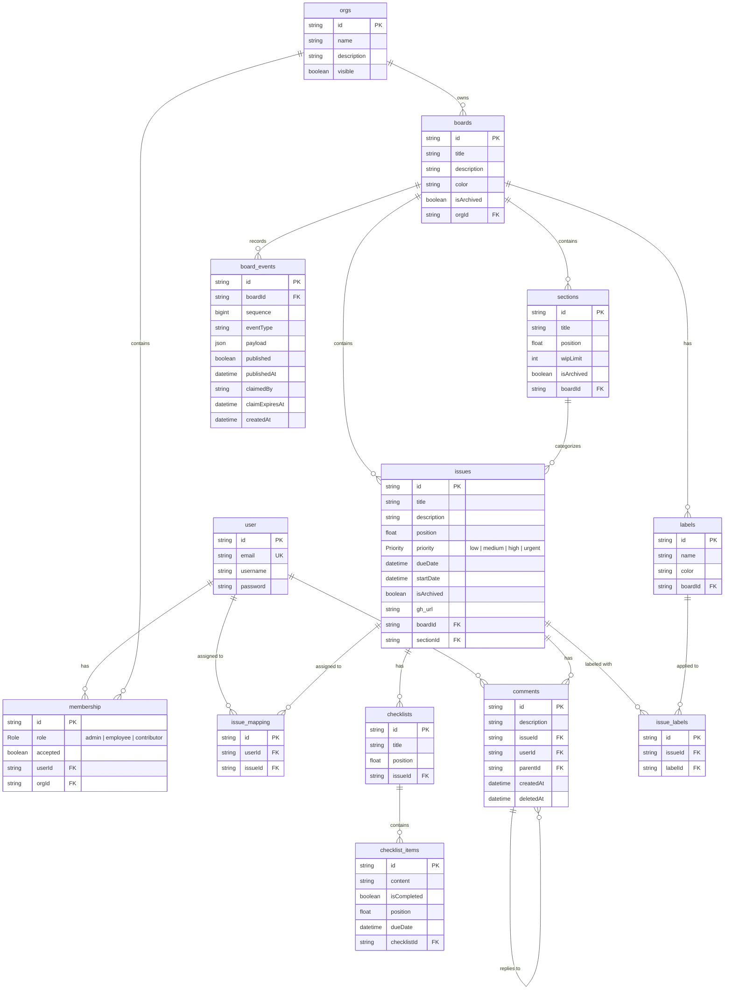

# 📋 Kanban Board (Trello Clone Monorepo)

A high-performance, real-time Kanban project management system built with **Bun**, **Turborepo**, **TypeScript**, **Express 5**, **Prisma ORM**, and **PostgreSQL**.

Designed for agile teams and organizations, this platform provides hierarchical workspace management, dynamic Kanban boards, customizable workflow columns, issue tracking with GitHub integration, nested threaded discussions, and a dedicated native **WebSocket engine** for real-time collaboration and presence tracking.

---

## 🚀 Tech Stack

| Domain                        | Technologies                                                                                                |
| :---------------------------- | :---------------------------------------------------------------------------------------------------------- |
| **Runtime & Package Manager** | [Bun](https://bun.com/) (v1.3+ / v1.4+)                                                                     |
| **Monorepo Engine**           | [Turborepo](https://turbo.build/repo) (v2)                                                                  |
| **Language**                  | [TypeScript](https://www.typescriptlang.org/) (Strict typing across all workspaces)                         |
| **Frontend Framework**        | [React 19](https://react.dev/) + [Vite](https://vite.dev/) (High-performance SPA)                           |
| **Frontend State & Cache**    | [TanStack Query v5](https://tanstack.com/query), [Zustand](https://zustand-demo.pmnd.rs/)                    |
| **Frontend Drag & Drop**      | [@dnd-kit](https://dndkit.com/) (`core` + `sortable`)                                                       |
| **Frontend UI & Styling**     | [Tailwind CSS](https://tailwindcss.com/), [Radix UI Primitives](https://www.radix-ui.com/), [Lucide React](https://lucide.dev/) |
| **Backend Framework**         | [Express 5](https://expressjs.com/) on Bun runtime                                                          |
| **Real-Time Engine**          | Native [Bun WebSockets](https://bun.com/docs/api/websockets) (Pub/Sub topics, room subscriptions, presence) |
| **Database & ORM**            | [PostgreSQL](https://www.postgresql.org/) with [Prisma ORM](https://www.prisma.io/) (`@prisma/adapter-pg`)  |
| **Authentication & Security** | JWT (`jsonwebtoken`), `bcrypt` password hashing, Role-Based Access Control (RBAC)                           |
| **Validation**                | [Zod](https://zod.dev/) schema validation for requests and environment configurations                       |
| **Testing**                   | Bun Test runner (`bun:test`), Supertest, custom integration, component & unit test suites (799 tests)        |

---

## ✨ Features

### 🏢 Organization & Multi-Tenancy

- **Organization Workspaces**: Create, edit, and manage multiple team workspaces with custom visibility settings.
- **Role-Based Access Control (RBAC)**: Support for `admin`, `employee`, and `contributor` roles.
- **Invitation Lifecycle & Cancellation**: Seamless member invitations, role updates, acceptance flows, and ability for admins to revoke or cancel pending invitations (`DELETE /api/orgs/:orgId/members`).

### 📊 Kanban Boards & Workflows

- **Dynamic Boards**: Create, rename (`PUT /api/boards/:boardId`), and organize multiple boards per organization.
- **Customizable Sections (Columns)**: Build flexible workflow pipelines (e.g., _Backlog_, _In Progress_, _In Review_, _Done_).
- **Position Offsets & Auto-Spacing**: Section and card positions automatically calculate based on maximum existing offsets (`max(position) + 1000`) to prevent position collisions.
- **Column Lifecycle & Reordering**: Reorder, rename (`PUT` / `PATCH`), or safely delete sections. Column positions (`position`) are persisted to the database and indexed. Deleting a non-empty section requires specifying a `targetSectionId` on the same board to reassign issues; if a section is the only one remaining on the board and contains issues, deletion is blocked until issues are manually handled.

### 📝 Issue / Card Management

- **Rich Task Cards**: Create issues with descriptions, metadata, priority levels (`low`, `medium`, `high`, `urgent`), start/due dates, and optional GitHub links (`gh_url`).
- **Flexible Movement**: Move cards seamlessly across sections or reorder positions within a section (`PATCH /api/cards/:id/move` or `/api/cards/:id`).
- **RESTful Card Aliases**: Full support for `/api/cards/*` routes alongside `/api/issues/*`.
- **Deduplicated Team Assignments**: Assign and unassign single or multiple team members to any card (`issue_mapping`) with automatic recipient deduplication.
- **Labels & Checklists**: Full support for board-scoped labels (`/api/boards/:boardId/labels`, card label attachments) and nested checklists with subtask items (`/api/issues/:issueId/checklists`).

### 🖥️ Modern React 19 Frontend SPA (`apps/frontend`)

- **Interactive Kanban Canvas**: Fluid drag-and-drop powered by `@dnd-kit` with midpoint position calculations (`dnd-math.ts`) for cards and columns, elevated drag overlays, droppable empty column placeholders, and optimistic updates with automatic rollback on mutation failure.
- **Real-Time WebSocket State Synchronization**: `useBoardSocket` hooks subscribe to board rooms, live presence stacks display collaborator avatars, and a synchronous in-memory event reducer updates TanStack Query caches instantly for moves, edits, labels, checklists, and comments. Sequence-based catch-up (`/events?sinceSeq=...`) guarantees seamless recovery after disconnects.
- **Multi-Criteria Board Search & Filtering**: Fast client-side filtering across text query (title/description), priority level, assignee (`all`, `me`, `unassigned`, or specific user), labels, and due date urgency. Displays active filter metrics and matching/total card ratios while keeping column WIP limit warnings calculated against total column cards so active filters never mask WIP limit violations.
- **Timezone-Safe Due Date Urgency System**: Custom parser (`parseDateParts`) handles calendar-only dates and midnight UTC ISO strings without premature overdue alerts on the due date or negative-timezone day shifts. Dynamically renders urgency badges (`overdue`, `due-today`, `due-soon`, `upcoming`, and `normal`).
- **Theme & Dark Mode Engine**: Persistent theme store (`light`, `dark`, `system`) with multi-tab storage synchronization, system preference change listeners, and an inline `<head>` script in `index.html` preventing flash of unstyled content (FOUC).
- **Responsive Mobile Layout**: Mobile navigation hamburger drawer, collapsible mobile board filter drawer, responsive column widths (`w-[82vw] sm:w-72`), and smooth horizontal touch-scrolling canvas.
- **Safety & Modal Guardrails**: Guarded column deletion requiring issue reassignment when cards exist, destination column selection stability against background query refetches, and rich card detail modal (checklists with completion ratios, label picker, and threaded discussion tree).

### ⚡ Real-Time Collaboration & Presence (WebSockets)

- **Native Pub/Sub Engine**: Board-scoped rooms (`board_<boardId>`) using Bun's native high-performance WebSocket publish/subscribe.
- **Ordered Event Sourcing & Advisory Locks**: Outbox event recording (`board_events`) using PostgreSQL transaction-level advisory locks (`pg_advisory_xact_lock`) ensuring strictly sequential, non-colliding event numbering across concurrent workers.
- **Transactional Outbox & Worker Leases**: Atomic DB mutations and event writes via `executeWithOutbox`. Resilient background outbox worker (`claimedBy`, `claimExpiresAt` leases) ensures safe, at-least-once event delivery across multiple backend instances without duplicate dispatch.
- **Catch-up Sync API**: Clients can query `/api/boards/:boardId/events?sinceSeq=<sequence>` to sync missing events after reconnecting.
- **Server-Side Heartbeat & Zombie Pruning**: Recurring ping/pong health checks (default 30s) automatically detect inactive sockets, respond to client heartbeat pings/pongs, and terminate dead zombie connections with presence broadcast updates.
- **Live Event Broadcasting**: Instant updates for card moves, creation, edits, deletions, checklist changes, labels, and column changes.
- **Presence Tracking & Targeted Eviction**: Real-time `user:joined` and `user:left` events with automatic connection-drop cleanup and administrative user/session eviction hooks (`/internal/evict-user`).
- **In-Memory Membership Registry & Fast-Path Eviction**: WebSocket server maintains an in-memory membership cache for zero-latency join verification and fast-path multi-board/org socket eviction without repeated database lookups.
- **Flexible Authentication**: Handshake-level JWT validation supporting headers, cookies, URL query parameters, and subprotocols.
- **Timing-Attack Resilient Auth**: Login handler utilizes constant-time dummy bcrypt hashing to prevent user enumeration and timing attacks.
- **Separate Backend and WebSocket Services**: Backend delivers events through the authenticated HTTP bridge (`/internal/broadcast`); the shared `realtime` package holds the event contracts used by both apps.

### 💬 Threaded Discussions & Comments

- **Hierarchical Comment Tree**: Infinite-depth nested replies powered by an optimized recursive tree algorithm (`commentTree`).
- **Audit & Editing Policies**: 24-hour edit window enforcement and soft-deletion support with standard HTTP 200 responses.

### 🗄️ Database Optimization

- **Composite Indexing**: Optimized indexes on `[boardId, sectionId]`, `[userId, orgId]`, `[boardId, sequence]`, and foreign key cascades.
- **Prisma Client Generation**: Tailored output with PostgreSQL native pooling adapter.

---

## 🏗️ Repository Architecture

```text
trello/
├── apps/
│   ├── backend/               # Express 5 REST API server running on Bun
│   │   ├── src/
│   │   │   ├── controllers/   # Auth, Org, Board, Section, Issue, & Comment handlers
│   │   │   ├── helpers/       # Comment tree builder, async wrappers, custom error classes, JWT helpers
│   │   │   ├── middlewares/   # JWT authentication & token generation
│   │   │   ├── models/        # Zod schemas for input validation
│   │   │   ├── routes/        # Express route definitions (with card & section aliases)
│   │   │   ├── services/      # WebSocketBroadcaster & Transactional Outbox Worker
│   │   │   └── types/         # TypeScript environment and entity typings
│   │   └── tests/             # Integration & unit test suites (179 unit tests)
│   │
│   ├── websockets/            # Native Bun WebSocket collaborative server
│   │   ├── src/
│   │   │   ├── auth/          # Handshake authentication & token extraction strategies
│   │   │   ├── server/        # Bun.serve WebSocket server, upgrade handlers, heartbeat & close hooks
│   │   │   ├── services/      # Broadcaster singleton, in-memory membership cache, & IPC handler
│   │   │   └── types/         # Client actions, server events, & payload interfaces
│   │   ├── tests/             # WebSocket test suites (128 tests across auth, pub/sub, heartbeat, upgrade)
│   │   └── index.ts           # WebSocket entrypoint & HTTP broadcast listener
│   │
│   └── frontend/              # High-performance React 19 + Vite Kanban SPA
│       ├── src/
│       │   ├── components/    # Board canvas, columns, cards, filter bar, modals, UI primitives
│       │   ├── hooks/         # useBoardSocket, useRole, useToast, API mutation hooks
│       │   ├── lib/           # board-filters, date-urgency, dnd-math, kanban-api, org-api
│       │   ├── pages/         # BoardCanvasPage, BoardsPage, LoginPage, SignupPage
│       │   ├── store/         # useAuthStore, useOrgStore, useThemeStore (Zustand)
│       │   └── tests/         # Unit, component, optimistic rollback, & adversarial suites (492 tests)
│       └── index.html         # SPA entrypoint with FOUC prevention script
│
├── packages/
│   ├── db/                    # Prisma schema, migrations, and PostgreSQL client
│   │   ├── prisma/            # schema.prisma, migration logs, and outbox event leases
│   │   ├── scripts/           # Database utilities (clearDB.ts)
│   │   └── db.ts              # Prisma client instance with PostgreSQL adapter
│   ├── realtime/              # Shared real-time event definitions, types, and topic helpers
│   │   ├── src/
│   │   │   └── index.ts       # BroadcastEvent, payloads, formatBoardTopic, cleanBoardId
│   │   └── package.json
│   ├── ui/                    # Shared React component library
│   ├── eslint-config/         # Monorepo-wide ESLint configurations
│   └── typescript-config/     # Base and framework-specific tsconfig definitions
│
├── package.json               # Workspace root configuration
├── turbo.json                 # Turborepo task pipeline definition
└── bun.lock                   # Bun lockfile
```

---

## 🗄️ Data Model



---

## 🌐 Real-Time WebSocket Protocol

The WebSocket server provides real-time event distribution and presence tracking across board collaborators.

### Connecting to WebSockets

- **Default URL**: `ws://localhost:3001`
- **Authentication**: JWT token must be provided through any of the following strategies:
  1. **Query Parameter**: `ws://localhost:3001?token=<JWT>` or `?access_token=<JWT>`
  2. **Authorization Header**: `Authorization: Bearer <JWT>`
  3. **Cookie**: `Cookie: token=<JWT>` or `auth_token=<JWT>`
  4. **Subprotocol**: `Sec-WebSocket-Protocol: bearer, <JWT>`

Unauthenticated connections are rejected at the HTTP handshake stage with **HTTP 401 Unauthorized**.

### Client-to-Server Actions

Send JSON frames over the WebSocket connection:

```jsonc
// 1. Join / Subscribe to a board room
{
  "action": "join", // or "subscribe"
  "boardId": "board-uuid"
}

// 2. Leave / Unsubscribe from a board room
{
  "action": "leave", // or "unsubscribe"
  "boardId": "board-uuid"
}

// 3. Heartbeat Ping / Pong
{
  "action": "ping" // or "heartbeat"
}
{
  "action": "pong" // or "heartbeat_ack"
}
```

> [!NOTE]
> The WebSocket server automatically runs server-side heartbeat intervals (default 30s) sending native ping frames and checking socket activity. Sockets that fail to respond before the subsequent heartbeat check are automatically terminated as zombie connections and broadcast `user:left` presence updates.

### Server-to-Client Broadcast Events

When actions occur via REST API or other clients, events are published to the board room topic (`board_<boardId>`):

| Event Type              | Payload Fields                               | Description                              |
| :---------------------- | :------------------------------------------- | :--------------------------------------- |
| `user:joined`           | `{ userId, name, email, boardId }`           | Collaborator entered the board           |
| `user:left`             | `{ userId, name, email, boardId }`           | Collaborator left or disconnected        |
| `board:member_evicted`  | `{ userId, orgId, boardId }`                 | Member removed from organization         |
| `board:evicted`         | `{ boardId, reason }`                        | Direct socket notification of eviction   |
| `card:created`          | `{ cardData: Issue }`                        | New card added to a column               |
| `card:updated`          | `{ cardId, updates: { ... } }`               | Card metadata, title, or fields modified |
| `card:moved`            | `{ cardId, sourceList, destList, position }` | Card dragged across columns or reordered |
| `card:deleted`          | `{ cardId }`                                 | Card removed from the board              |
| `card:label_attached`   | `{ issueId, labelId, label }`                | Label attached to card                   |
| `card:label_removed`    | `{ issueId, labelId }`                       | Label removed from card                  |
| `checklist:created`     | `{ checklist }`                              | Checklist added to card                  |
| `checklist:deleted`     | `{ checklistId, issueId }`                   | Checklist deleted                        |
| `checklist_item:created`| `{ item }`                                   | Item added to checklist                  |
| `checklist_item:updated`| `{ item }`                                   | Checklist item toggled or updated        |
| `list:created`          | `{ listData: Section }`                      | New column added to the board            |
| `list:updated`          | `{ listId, title, wipLimit?, isArchived? }`  | Column renamed or updated                |
| `list:reordered`        | `{ listId, newPosition }`                    | Column reordered                         |
| `list:deleted`          | `{ listId }`                                 | Column deleted                           |

### HTTP Endpoints on WebSocket Server

- `GET /health` or `GET /api/health`: Health status and port inspection.
- `POST /internal/broadcast`: Inter-process broadcast hook used by Express backend to dispatch real-time events to connected board subscribers. Authenticated via `x-internal-secret: <INTERNAL_BROADCAST_SECRET>` (falls back to `jwt_key`).
- `POST /internal/evict-user`: Inter-process user socket eviction endpoint used upon member removal or privilege revocation to close active connections or unsubscribe from revoked boards. Authenticated via `x-internal-secret: <INTERNAL_BROADCAST_SECRET>` (falls back to `jwt_key`).

---

## 📡 REST API Reference

All protected routes require a Bearer token in the `Authorization` header:
`Authorization: Bearer <jwt_token>`

### 🔐 Authentication & Profile

| Method | Endpoint           | Description                                                  | Access        |
| :----- | :----------------- | :----------------------------------------------------------- | :------------ |
| `POST` | `/api/auth/signup` | Register a new user                                          | Public        |
| `POST` | `/api/auth/login`  | Authenticate user (timing-attack resistant) and receive JWT  | Public        |
| `GET`  | `/api/users/me`    | Fetch authenticated user profile                             | Authenticated |

### 🏢 Organizations & Memberships

| Method   | Endpoint                   | Description                                                    | Access         |
| :------- | :------------------------- | :------------------------------------------------------------- | :------------- |
| `GET`    | `/api/orgs`                | List all organizations for current user                        | Authenticated  |
| `POST`   | `/api/orgs`                | Create a new organization                                      | Authenticated  |
| `GET`    | `/api/orgs/:orgId`         | Get details of a specific organization                         | Member         |
| `PUT`    | `/api/orgs/:orgId`         | Update organization details                                    | Org Admin      |
| `DELETE` | `/api/orgs/:orgId`         | Delete organization                                            | Org Admin      |
| `GET`    | `/api/orgs/:orgId/members` | List members and their roles (Member only, 200 OK)             | Member         |
| `POST`   | `/api/orgs/:orgId/members` | Invite a user to an organization                               | Org Admin      |
| `PUT`    | `/api/orgs/:orgId/accept`  | Accept an organization invitation                              | Invitee        |
| `PUT`    | `/api/orgs/:orgId/members` | Update a member's role                                         | Org Admin      |
| `DELETE` | `/api/orgs/:orgId/members` | Remove user, leave org, or cancel/revoke pending invitations   | Member / Admin |

### 📋 Boards & Event Sync

| Method   | Endpoint                                              | Description                                           | Access    |
| :------- | :---------------------------------------------------- | :---------------------------------------------------- | :-------- |
| `GET`    | `/api/orgs/:orgId/boards`                             | List all boards in an organization                    | Member    |
| `POST`   | `/api/orgs/:orgId/boards`                             | Create a new board                                    | Member    |
| `GET`    | `/api/boards/:boardId`                                | Get board details with sections and issues            | Member    |
| `PUT`    | `/api/boards/:boardId`                                | Rename / update board details                         | Member    |
| `DELETE` | `/api/boards/:boardId`                                | Delete board and associated data                      | Org Admin |
| `GET`    | `/api/boards/:boardId/events`<br>`/api/boards/:id/events` | Catch-up sync missed board events (`?sinceSeq=&limit=`) | Member |

### 📑 Sections (Columns)

| Method          | Endpoint                        | Description                                                                                     | Access    |
| :-------------- | :------------------------------ | :---------------------------------------------------------------------------------------------- | :-------- |
| `GET`           | `/api/boards/:boardId/sections` | List sections for a board (sorted by `position`)                                                | Member    |
| `POST`          | `/api/boards/:boardId/sections` | Create a new section (`list:created`, auto-spaced `position`)                                    | Member    |
| `PUT` / `PATCH` | `/api/sections/:sectionId`      | Rename (`title`), set `wipLimit`, archive, or reorder (`position` / `newPosition`)              | Member    |
| `DELETE`        | `/api/sections/:sectionId`      | Delete section; requires `targetSectionId` if section has issues (`list:deleted`)                | Org Admin |

### 📌 Issues (Cards) & Assignments

| Method          | Endpoint                                                              | Description                                                                     | Access |
| :-------------- | :-------------------------------------------------------------------- | :------------------------------------------------------------------------------ | :----- |
| `GET`           | `/api/sections/:sectionId/issues`<br>`/api/sections/:sectionId/cards` | List cards in a section                                                         | Member |
| `POST`          | `/api/sections/:sectionId/issues`<br>`/api/sections/:sectionId/cards` | Create a card (`card:created`, auto-spaced `position`)                          | Member |
| `GET`           | `/api/issues/:issueId`<br>`/api/cards/:issueId` / `:id`               | Get full card details                                                           | Member |
| `PATCH`         | `/api/issues/:issueId`<br>`/api/cards/:issueId` / `:id`               | Update card title, priority, due date, start date, archive status, or move      | Member |
| `PATCH`         | `/api/cards/:issueId/move`<br>`/api/cards/:id/move`                   | Explicitly move card across sections or positions (`card:moved`)                | Member |
| `DELETE`        | `/api/issues/:issueId`<br>`/api/cards/:issueId` / `:id`               | Delete card (`card:deleted`)                                                    | Member |
| `POST`          | `/api/issues/:issueId/assignees`                                      | Assign users to card with email deduplication                                  | Member |
| `DELETE`        | `/api/issues/:issueId/assignees`                                      | Remove user assignment                                                          | Member |

### 🏷️ Labels

| Method   | Endpoint                                  | Description                                   | Access    |
| :------- | :---------------------------------------- | :-------------------------------------------- | :-------- |
| `POST`   | `/api/boards/:boardId/labels`             | Create a new label on a board                 | Member    |
| `GET`    | `/api/boards/:boardId/labels`             | List all labels defined on a board            | Member    |
| `POST`   | `/api/issues/:issueId/labels`             | Attach a label to an issue/card               | Member    |
| `DELETE` | `/api/issues/:issueId/labels/:labelId`    | Detach a label from an issue/card             | Member    |

### ✅ Checklists & Subtasks

| Method   | Endpoint                              | Description                                      | Access    |
| :------- | :------------------------------------ | :----------------------------------------------- | :-------- |
| `POST`   | `/api/issues/:issueId/checklists`     | Create a checklist on a card                     | Member    |
| `POST`   | `/api/checklists/:checklistId/items`  | Add an item/subtask to a checklist               | Member    |
| `PATCH`  | `/api/checklists/items/:itemId`       | Update checklist item content, completion, or due date | Member |
| `DELETE` | `/api/checklists/:checklistId`        | Delete an entire checklist                       | Member    |

### 💬 Threaded Comments

| Method   | Endpoint                        | Description                                     | Access         |
| :------- | :------------------------------ | :---------------------------------------------- | :------------- |
| `GET`    | `/api/issues/:issueId/comments` | Get nested comment tree for an issue            | Member         |
| `POST`   | `/api/issues/:issueId/comments` | Post a comment or reply to an existing one      | Member         |
| `PUT`    | `/api/comments/:commentId`      | Edit a comment (within 24-hour limit, 200 OK)   | Author         |
| `DELETE` | `/api/comments/:commentId`      | Delete a comment (200 OK)                       | Author / Admin |

---

## 🛠️ Getting Started

### Prerequisites

- **[Bun](https://bun.com/)** (`>= 1.3.0`)
- **[Node.js](https://nodejs.org/)** (`>= 18.0.0`)
- **[PostgreSQL](https://www.postgresql.org/)** running locally or hosted

### 1. Clone & Install Dependencies

```bash
git clone <repository-url>
cd trello
bun install
```

### 2. Configure Environment Variables

Create `.env` configuration files:

**`packages/db/.env`**:

```env
DATABASE_URL="postgresql://<user>:<password>@localhost:5432/<database_name>"
```

**`apps/backend/.env`**:

```env
port="3000"
jwt_key="your-super-secret-jwt-key"
ws_port="3001"
WS_INTERNAL_URL="http://127.0.0.1:3001"
INTERNAL_BROADCAST_SECRET="your-internal-service-secret"

# Optional Outbox worker configuration
OUTBOX_RETRY_INTERVAL_MS="5000"
OUTBOX_LEASE_MS="30000"
```

**`apps/websockets/.env`**:

```env
ws_port="3001"
jwt_key="your-super-secret-jwt-key"
INTERNAL_BROADCAST_SECRET="your-internal-service-secret"
WS_IDLE_TIMEOUT="60"
WS_HEARTBEAT_INTERVAL="30000"
```

> [!IMPORTANT]
> The `jwt_key` values must match for WebSocket JWT validation. Set the same `INTERNAL_BROADCAST_SECRET` in both apps for internal HTTP calls; when omitted, the JWT secret is used as a compatibility fallback. `WS_INTERNAL_URL` should point from backend to the WebSocket service.

### 3. Setup the Database

Generate Prisma Client and apply migrations:

```bash
# Apply migrations and generate Prisma client
bun --filter db exec prisma migrate dev
bun --filter db exec prisma generate
```

### 4. Run Development Servers

Start the two apps as **separate processes**. They can run on the same machine initially; backend sends broadcasts to the WebSocket service over HTTP.

For local development, from the repo root:

```bash
bun run dev --filter=backend
bun run dev --filter=websockets
```

Run each command in its own terminal. Configure both apps with matching `jwt_key` values. Set the same `INTERNAL_BROADCAST_SECRET` in both, and set the backend’s `WS_INTERNAL_URL` to the WebSocket service address, for example `http://127.0.0.1:3001`. The internal secret can fall back to the JWT secret, but configuring it separately is preferable.

*(Alternatively, you can start both services concurrently from the repo root with `bun run dev`)*

---

## 🔄 How events flow

1. A client makes a change through the backend API.
2. The backend writes the change and its event to the database outbox.
3. The backend publisher sends the event to `WS_INTERNAL_URL/internal/broadcast`.
4. The WebSocket service publishes it to connected clients subscribed to that board.
5. If delivery fails, the outbox leaves the event pending for retry.

This works whether the two processes are on the same machine or separate machines; the URL and network access are the difference.

### 🛡️ Outbox Delivery Resilience & Offline Fail-Safety

In production, network boundaries and service lifecycles can decouple:
- **Startup Race Conditions & Restarts**: When backend containers boot before the WebSocket service, or during rolling updates and transient network partitions, the WebSocket HTTP bridge may be temporarily unreachable.
- **Graceful Fail-Safe Delivery**: `WebSocketBroadcaster.broadcast()` catches connection and transport errors cleanly without throwing unhandled exceptions or crashing the backend process. Local in-process `EventEmitter` listeners still receive the broadcast (`emitted = true`), and the method returns `false`.
- **Transactional Outbox Coordination**: The transactional outbox worker explicitly checks this `false` return value. Rather than dropping the event or assuming delivery, it retains the event in `published: false` status, allowing the background lease worker to reliably retry delivery via `retryPendingEvents()` once the WebSocket service is back online.
- **Port Override Precedence for Test & Multi-Instance Isolation**: Calling `broadcaster.setPort(port)` explicitly sets `customPort = true`, guaranteeing that explicit port assignments take precedence over static `env.WS_INTERNAL_URL` defaults. This enables isolated automated testing against unused ports (e.g., verifying offline fail-safety without interference from local running dev servers) and supports custom multi-port internal routing.

---

## 📈 Scaling

**Initially:** run one backend and one WebSocket process. They may share a machine, but the HTTP boundary stays the same.

**More backend capacity:** run multiple backend processes against the shared database. The outbox lease mechanism coordinates event delivery so workers can claim pending events safely. Ensure all backends use the same WebSocket URL and internal secret.

**More WebSocket capacity:** the current HTTP endpoint reaches one WebSocket service target. Before running multiple WebSocket replicas, add a broker such as Redis Pub/Sub so an event reaches every replica; otherwise clients connected to other replicas can miss updates. Keep the backend publishing through the same service boundary, then have the WebSocket instances consume the broker and publish to their own local clients.

One caveat: user eviction also currently uses the single WebSocket HTTP target, so with multiple WebSocket replicas that operation will need broker fan-out too.

---

## 🧪 Testing

The repository features comprehensive automated testing using Bun's native test runner (`bun:test`), totaling **799 automated tests** across all monorepo packages:

```bash
# 1. Run all tests across the monorepo (799 tests)
bun run test

# 2. Run Frontend unit, component, & adversarial tests (492 tests)
bun test --cwd apps/frontend

# 3. Run WebSocket unit and integration tests (128 tests)
bun test --cwd apps/websockets

# 4. Run Backend unit tests (helpers, middleware, Zod schemas, parity, & broadcast dispatches) (179 tests)
bun test apps/backend/tests/unit

# 5. Run Full Backend integration tests (requires PostgreSQL test database)
bun test --cwd apps/backend

# 6. Type check all monorepo packages (5 packages)
bun run check-types

# 7. Lint check across monorepo with zero-warning enforcement
bun run lint
```

> [!NOTE]
> Database integration tests depend on `packages/db/scripts/clearDB.ts` (configured in `turbo.json`) to automatically truncate tables before runs in the test database (`trello_test`).

---

## 🗺️ Roadmap

- [x] Monorepo orchestration with Turborepo & Bun
- [x] Relational schema design with Prisma & PostgreSQL
- [x] Authentication & Role-Based Access Control (RBAC) with timing-attack prevention
- [x] Multi-tenant organization & membership management with pending invitation revoking
- [x] Board and workflow section (column) management with auto-spaced positions
- [x] Issue lifecycle, movement across columns, and position reordering
- [x] RESTful Card and Section aliases (`/api/cards/*`, `PATCH /move`)
- [x] Multi-user card assignments (`issue_mapping`) with email deduplication
- [x] Card labels & checklist subtasks with position ordering
- [x] Threaded nested comment tree with edit time limits (200 OK responses)
- [x] Native WebSocket server with board pub/sub rooms
- [x] Event sourcing with advisory locks (`pg_advisory_xact_lock`) and catch-up event sync
- [x] Transactional outbox pattern with worker leasing (`claimedBy`, `claimExpiresAt`) and guaranteed event publishing
- [x] Shared real-time event contract package (`packages/realtime`)
- [x] In-memory membership registry & fast-path join/eviction handling
- [x] Server-side heartbeat intervals and automatic zombie socket cleanup
- [x] Multi-strategy handshake authentication (Headers, Cookies, Query, Subprotocol)
- [x] Real-time presence tracking (`user:joined`, `user:left`) and targeted member eviction
- [x] Automatic WebSocket disconnect cleanup
- [x] Inter-process event synchronization (`WebSocketBroadcaster` with HTTP bridge)
- [x] React 19 frontend SPA with drag-and-drop Kanban board (`dnd-kit`), optimistic updates, and WebSocket synchronization
- [x] Multi-criteria board search, filter bar, and timezone-safe due date urgency system
- [x] Theme engine with dark mode, system preference detection, and FOUC prevention
- [x] Comprehensive test suites (128 WebSocket tests + 179 Backend unit tests + 492 Frontend tests = 799 tests across the monorepo)
- [ ] GitHub webhook integration for automated card syncing
- [ ] Card activity log and audit history
- [ ] File attachments
